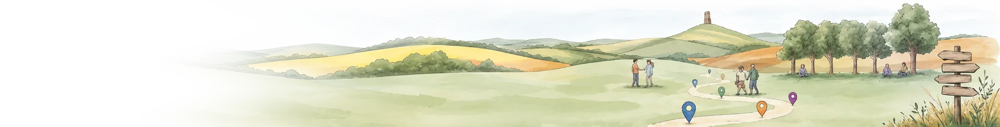

# Signposting Somerset

**Connecting people with local mental health and wellbeing support.**

👉 **https://signpostingsomerset.org.uk**

---

### 🗺️ The directory

**A checked directory of local mental health and wellbeing support:** crisis support, peer groups, activities, practical help with money, housing and food, and one-to-one support, in person, by phone and online.

- **Over 750 services from more than 200 providers,** each checked against the provider's own information and dated.
- **What's on, not just who exists:** the next session for every service, worked out for you, on a map and in a list.
- **Search by need, place and time,** within a few miles of any town or point on the map.
- **Phone and online support** in its own tab, including helplines open right now, and **courses** with set dates.
- **Copy any service** as plain text, ready to paste into a message or case notes.
- **Safety on every screen:** 999, NHS 111 (option 2), Mindline and Samaritans, plus a quick-exit button. Crisis Safe Space addresses are never published.

Open to everyone. Built mainly for support workers and volunteers helping someone else find support. [More about the directory](docs/main/README.md)

---

### 🧭 Assist (for invited support workers)

The **Assist** tab turns a short description of someone's situation into a support plan drawn from the checked directory: specialist help for the core need first, then gentle next steps, each with a reason it might help. Plans can be copied, shared or printed. An access code is required. [More about Assist](docs/test/README.md)

- **Privacy first:** names, contact details and other personal information are removed in the browser before anything is sent to the AI, and only a rounded location (about 1 km) is used.
- **Needs first:** risk and specialist needs (such as gambling, drinking or an eating disorder) and practical problems (debt, housing, food) are each covered by their best service before wellbeing groups, which go alongside, never instead.
- **Matched to the person,** using the Five Ways to Wellbeing: a low-pressure first step for someone who is anxious or withdrawn, and side-by-side activities for someone who doesn't want to sit and talk.
- **Optional online search** for gaps in the directory. Anything found online is clearly marked "Found online, not checked", and shown in the same format as directory services.
- The support worker always makes the final decision.

---

### 📋 What testing has taught us

Assist has been tested on realistic, multi-need scenarios (for example: gambling debts with suicidal thoughts; first-episode psychosis; low mood after a stroke; perinatal OCD; a male victim of domestic abuse) and compared, blind, with ChatGPT given the same prompts.

- **Choices were good; gaps were mostly in the data.** Where Assist lost marks, it was usually because a record was incomplete (no times, no phone), not because it picked the wrong service. Fixing records improved results more than changing the AI.
- **Fewer misleading suggestions.** ChatGPT (Pro) found slightly more options, but about 1 in 5 of its suggestions couldn't be found or were contradicted by the provider. Assist's suggestions come from checked records: about 1 in 20 were misleading, both data errors since corrected. Counting misleading suggestions against each, Assist scored about 2.9 useful suggestions per request against ChatGPT's 2.25.
- **The directory is the product.** Assist is a helpful layer on top, but only as good as the records underneath. The most valuable work is keeping the data complete and current, and gaps found during testing are added to the directory after checking.

---

**Demo version.** Every service is checked against the provider's own information, but services change: please confirm with the service before attending.

Spotted something out of date, or know a service that should be listed? [**Suggest a change**](https://docs.google.com/forms/d/e/1FAIpQLSf8NCl7EpGkgKNACUMDJEFzToJnoQp_xs7Fj0E9z4o2pLiqOQ/viewform).

<b>How it's built</b>

- **Records** live in a shared Google Sheet, so people with local knowledge can keep them up to date. The site reads the published sheet directly, so changes appear within minutes.
- **The site** is a single static page hosted on GitHub Pages (`docs/main/` is live; `docs/test/` is for trying changes first), with images in `docs/assets/`.
- **Assist** runs through a small Cloudflare Worker (`src/cloudflare-worker.js`) that checks the access code, chooses candidate services by distance (removing personal details again before any online search), and asks Claude (Anthropic) for the plan. The API key and access code are kept in Cloudflare, never in this repository.
- **Tools** in `src/` help check the sheet and add map locations.

*It started from a Padlet of local services created by colleagues at a Somerset mental health charity. Service information belongs to the providers listed. Map data © [OpenStreetMap](https://www.openstreetmap.org/copyright) contributors, © [CARTO](https://carto.com/attributions).*
